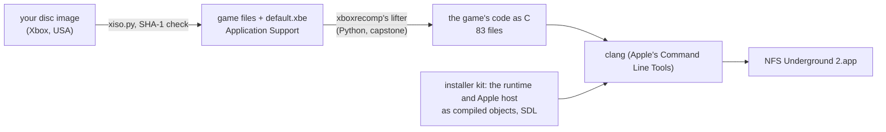
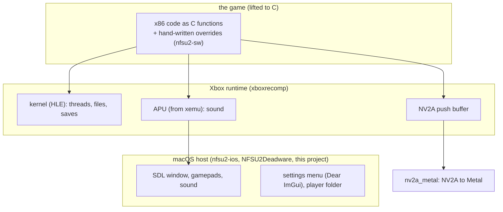

# NFS Underground 2 for Mac

*Need for Speed: Underground 2* (EA Black Box, 2004), the original Xbox version, running natively on Apple Silicon Macs.

This is a "clean" Mac build of the Xbox static recompilation of the game: the disc's own textures, text and movies, with the
engine improvements that make it play well on a Mac (60 or 120 fps, a 16:10 picture without bars, a higher render resolution,
Metal effects). Nearly everything here is other people's work:

- [nfsu2-sw](https://github.com/antoxa2584x/nfsu2-sw) by **antoxa2584x** lifts the game's x86 code to C with
  [xboxrecomp](https://github.com/sp00nznet/xboxrecomp) by **sp00nz** and runs it on xboxrecomp's Xbox runtime.
- [nfsu2-ios](https://github.com/myUdav4iik/nfsu2-ios) by **myUdav4iik** adds the Apple host and the Metal renderer.
- [NFSU2Deadware](https://github.com/LeoDeadware/NFSU2Deadware) by **LeoDeadware** makes it a Mac game: render scale, 16:10,
  60/120 fps pacing, Metal effects, and the "build it on the player's Mac" installer this project follows. This port uses its
  engine patches without its HD texture packs and translation.

This project adds an in-game settings menu (in the style of SpeedBreaker's), the app's player folder and an installer in the
style of the
[NFS Hot Pursuit 2 port](https://github.com/sanyokkua/nfs-hp2-ps2-port). All thanks go to the projects above (see
[Credits](#credits)).

## Status

Races, the menus, Quick Race and saves work at 60 fps on an M1 Pro with a gamepad. But:

- It is **not actively supported**: an experiment, worked on when time allows.
- The game has **not been played from start to finish** on it; long Career sessions are untested.
- Apple Silicon and macOS 15 or newer only. Only the **Xbox USA disc** is supported (`default.xbe` SHA-1 `428b5a70…`); the
  European and Japanese editions have another program and would need their own build.

How the port was made: [docs/PORTING.md](docs/PORTING.md). Changes per version: [CHANGELOG.md](CHANGELOG.md).

## Install

You need an **Apple Silicon Mac with macOS 15 or newer** and your own disc image (ISO) of the **USA Xbox release** of
*Need for Speed: Underground 2*. No game files are included, and no game code: the game is built on your Mac from your disc.

1. Download `NFS-Underground-2-<version>.dmg` from [Releases](https://github.com/sanyokkua/nfsu2-xbox-port/releases/latest),
   open it and drag **NFS Underground 2 Installer** to Applications.
2. **Open it.** The installer isn't notarized by Apple, so the first time macOS refuses. Close that message (don't move it to the
   Trash), go to **System Settings > Privacy & Security**, scroll to the message about it, click **Open Anyway** and confirm.
3. **Apple's Command Line Tools.** The game is compiled on your Mac with them. If they aren't installed, macOS offers to install
   them: click Install, and the installer goes on by itself when they are there.
4. **Choose your disc image.** The installer copies the game's files (2.6 GB) into
   `~/Library/Application Support/NFS Underground 2`, checks the program (`default.xbe` must be the USA release's), translates it
   to C and compiles it. On an M1 Pro that takes about 4 minutes, once.
5. **NFS Underground 2** is put in Applications (in `~/Applications` when Applications isn't writable) and opens. Play it from
   there; you can delete the disc image and the installer afterwards. Opening the installer again offers Play or Rebuild.

**The settings menu** opens over the game with **Back + Start** on a controller, **F1** (on a MacBook: **fn+F1**, unless the
F-keys are set as standard keys) or **Cmd+,**. The D-pad or left stick chooses and changes, **A** toggles, **LB/RB** turn the
pages, **B** closes; on a keyboard the arrows, Enter, Q/E (or Tab) and Esc; the mouse works too. While it is open the game gets no
input. Under the rows, the chosen setting says what it does, **where** you will see it (races and the city, the whole picture,
menus...) and, once changed, whether it is applied now or after a restart. At the bottom: **Reset page**, **Close** and **Quit
Game** (it asks first).

| Page | Setting | Choices | Applies |
|---|---|---|---|
| Display | Display | Window, Full Screen | now (F11 also switches, for this run) |
| | Resolution Scale | 1x, 1.5x, 2x, 2.5x, 4x (default) | now; the same as the game's **Options > Video** row |
| | Frame Rate | 60 fps (default), 120 fps, 30 fps (the original) | at the next start (the row says "restart") |
| Graphics | Anti-Aliasing, Anisotropic Filtering, Square Pixels, Car Reflections | the game's **Options > Video** rows | now |
| | Draw Distance | Normal (the original), Far (x2) | now |
| | Gamma | Original, Modern (brighter), Warm | now |
| | Effects | Bloom (default), Bloom + Ambient Occlusion, Off | now |
| | Motion Blur | Off (default), On | now |
| Audio | Master Volume | 0-100% (50% default) | now |
| Input | Vibration | Off, 10-100% (also the game's **Options > Gameplay**) | now |
| | Keyboard as Controller | Without a controller (default), Always, Off | at the next start |
| Advanced | Performance Overlay | fps and the slowest frame (also **Cmd+Option+F**) | now |
| | Logs | opens the logs folder in Finder | |

**Cmd+Q** quits too. Gamepads: anything macOS knows (Xbox, PlayStation, MFi), with rumble; without one, the keyboard drives
(arrows/WASD, Enter = A + Start, Esc = B, P = Start).

**Your files:** `~/Library/Application Support/NFS Underground 2/`: `game/` (the disc's files and the game's saves, `UDATA/`),
`player/` (`settings.ini`: the settings menu's, `nfsu2x_options.txt`: the game's Options rows), `saves/` and `cache/` (the runtime's), `logs/` (the game's and the installer's).

## How it works

The game's code isn't emulated: its x86 code is translated into C once, compiled for Apple Silicon, and runs on a runtime that does
what the Xbox's hardware and kernel did.

### Build time: from the disc to an app



### Run time: what happens while you play



- **CPU:** xboxrecomp's lifter turns each x86 function of `default.xbe` into a C function on the Xbox's registers and its
  memory, mapped at the Xbox's own addresses. nfsu2-sw adds the seeds the static pass misses and hand-written overrides
  (movies, the D3D fence, the Options rows).
- **Graphics:** the game's Direct3D writes NV2A push buffers as on an Xbox; the runtime reads them and nfsu2-ios's `nv2a_metal`
  draws them with Metal, at a higher resolution. NFSU2Deadware's patches add 16:10, pacing, bloom, ambient occlusion and motion
  blur there.
- **Sound:** the Xbox's audio processor is emulated (code from xemu) and played through SDL.

## Build from source (macOS, Apple Silicon)

```sh
brew install cmake ninja
python3 -m venv .venv && .venv/bin/pip install 'capstone<6'
# your disc's files into game/extracted:  python3 mac/import_disc.py <your .iso> game/extracted
tools/build_deps.sh                   # SDL3 + sdl2-compat for macOS 15+ -> build/deps
tools/build_release.sh                # lift (engine/gen) + the Metal build -> build/release/nfsu2_recomp
tools/smoke.sh                        # boot check: 75 s, START presses, the settings menu, the last frame not black
tools/play.sh                         # play the dev build (its own player folder)
tools/make_dmg.sh                     # the players' installer DMG (no game code; checked by tests/dmg_no_game_code.sh)
```

Everything the port is built from is in this repository: `engine/` is the recompilation and runtime (nfsu2-ios with
NFSU2Deadware's patches and ours, how it was made: [docs/upstream-patches/](docs/upstream-patches/)), with Dear ImGui and its
font in `engine/third_party/`. The repository holds no game files and no generated code. Releases are the installer: it carries
the lifter and the runtime as compiled objects and builds the game on the player's Mac.

## Diagnostics

Upstream's environment variables work, for example `NFSU2_GAME_DIR=<folder>` (the game's files; then no player folder is used),
`NFSU2_FPS_CAP=30|60|120` (a variable set by hand wins over the menu for that run), `RECOMP_GL_DUMP=<prefix>,<frames>` (frame
dumps), `RECOMP_FPS_LOG=1`, `NFSU2_SMOKE_SECONDS=<n>`, `NFSU2_OVERLAY_SCRIPT="<s>:open,<s>:next,..."` with
`NFSU2_OVERLAY_SHOT=<prefix>` (scripted menu steps and screenshots of it).
The installer: `NFSU2_IMPORT_ISO=<iso>`, `NFSU2_INSTALL_DIR=<folder>`, `NFSU2_NO_UI=1`. Logs are in
`~/Library/Application Support/NFS Underground 2/logs/`.

## Credits

| Project | Author | What it gives this port | License |
|---|---|---|---|
| [nfsu2-sw](https://github.com/antoxa2584x/nfsu2-sw) | antoxa2584x (Anton Artemov) | the game's recompilation: seeds, overrides, Options rows, movies | no license file upstream; used here with credit, under this project's GPL-3.0-or-later |
| [nfsu2-ios](https://github.com/myUdav4iik/nfsu2-ios) | myUdav4iik | the Apple host and the Metal renderer | no license file upstream; as above |
| [xboxrecomp](https://github.com/sp00nznet/xboxrecomp) | sp00nz | the Xbox lifter and runtime | MIT |
| [xemu](https://github.com/xemu-project/xemu) | xemu team | the APU and NV2A parts in xboxrecomp | LGPL-2.1-or-later |
| [NFSU2Deadware](https://github.com/LeoDeadware/NFSU2Deadware) | LeoDeadware | the Mac engine patches, the kit builder, disc import, icon, the installer model | MIT |
| [SpeedBreaker](https://github.com/SpeedBreakerProject) | project(u) | the idea and the style of these Mac ports, the settings menu's design | GPL-3.0 |
| [Dear ImGui](https://github.com/ocornut/imgui) 1.92.9 | Omar Cornut | the settings menu's drawing (Metal backend) | MIT |
| [Roboto](https://fonts.google.com/specimen/Roboto) Medium | Google | the settings menu's font | Apache-2.0 |
| [Capstone](https://github.com/capstone-engine/capstone) | Capstone team | the lifter's disassembler | BSD-3-Clause |
| [SDL3](https://github.com/libsdl-org/SDL), [sdl2-compat](https://github.com/libsdl-org/sdl2-compat) | SDL team | window, input, gamepads, sound | Zlib |

The license texts: [LICENSES/](LICENSES/) and, in the installer, `Contents/Resources/kit/licenses/`. Details:
[THIRD_PARTY_NOTICES.md](THIRD_PARTY_NOTICES.md).

## License

GPL-3.0-or-later ([LICENSE](LICENSE), [NOTICE](NOTICE)). This project is built on nfsu2-sw and nfsu2-ios; their files keep their
authorship; how `engine/` was made is in [docs/upstream-patches/](docs/upstream-patches/), and later changes are in this
repository's history. **If you reuse this code, keep the credit to those projects and
their links**, as we do. NFSU2Deadware's patches and scripts stay under the MIT License; xboxrecomp's xemu parts under the
LGPL-2.1 (the installer links them on the player's Mac, so they can be relinked).

## Legal notice

Unofficial fan project, not affiliated with or endorsed by Electronic Arts or Microsoft. *Need for Speed* and *Underground* are
trademarks of Electronic Arts Inc.; Xbox is a trademark of Microsoft. This repository and its releases contain no game code and no
game data: you need your own legally obtained copy of the game, and the game is built from it on your own Mac.
